# SecureOTA

**Signed, verified over-the-air firmware updates for ESP32 fleets, with automatic rollback when a new build fails.**

[](https://github.com/Rithik-sharma12/Secure_OTA_Update_Security_Mechanism/actions/workflows/ci.yml)
[](https://github.com/Rithik-sharma12/Secure_OTA_Update_Security_Mechanism/actions/workflows/firmware-release.yml)

<p align="center">
  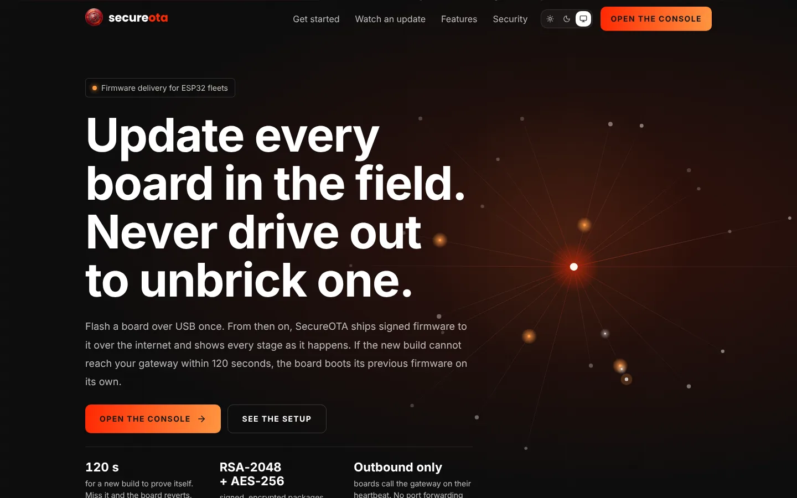
</p>

SecureOTA is a full-stack platform for updating microcontroller firmware in the field without bricking boards. A board is flashed and provisioned over USB once. After that, every release reaches it over the internet: the gateway signs it, the board verifies it before writing a byte, and a new build that cannot reach the gateway within 120 seconds is rolled back by the bootloader.

The project has three parts that ship together:

| Part | Folder | Stack | Role |
|---|---|---|---|
| Web console | [`apps/web`](apps/web) | Next.js 16, React 19, TypeScript, Tailwind 4 | Landing page, sign-in, fleet console, USB flashing in the browser |
| Edge gateway | [`apps/gateway`](apps/gateway) | Python 3.11, FastAPI | Device registry, heartbeats, release signing, deployments, audit trail |
| Device firmware | [`firmware`](firmware) | C++ (Arduino-ESP32 2.0.17 via PlatformIO) | Secure OTA client, health gate, USB provisioning |

A small local agent ([`apps/agent`](apps/agent)) lets the hosted console reach the USB ports of the computer viewing it.

---

## Contents

1. [How it works](#how-it-works)
2. [UX workflow](#ux-workflow)
3. [Architecture](#architecture)
4. [Security model](#security-model)
5. [Screenshots](#screenshots)
6. [Repository layout](#repository-layout)
7. [Getting started](#getting-started)
8. [Configuration](#configuration)
9. [Firmware](#firmware)
10. [Gateway API](#gateway-api)
11. [Testing and CI](#testing-and-ci)
12. [Design rules](#design-rules)
13. [Documentation](#documentation)
14. [Team and license](#team-and-license)

---

## How it works

1. **Flash once over USB.** From the Devices page, the console flashes a release over the board's COM port (Web Serial in Chrome or Edge, or the local agent) and writes its Wi-Fi, gateway address and a per-device token into NVS.
2. **Publish a release.** Upload a compiled `.bin` on the Releases page, or let the GitHub release workflow publish it. The gateway records its SHA-256 and signs the release with its Ed25519 key.
3. **Deploy.** Choose a release and a set of boards. The gateway refuses wrong-architecture boards, quarantined boards (health score below 40) and downgrades, and says why per device.
4. **The board updates itself.** It learns about the job in its next heartbeat (every 30 s by default), downloads the image, checks the digest and signature, writes the spare partition and reboots on probation.
5. **Health gate.** The new image must join Wi-Fi and get an accepted heartbeat within 120 s. If it does, it is marked valid. If not, the bootloader boots the previous firmware.
6. **Confirmation.** A deployment counts as done only when the board itself reports the new version. Deployments not confirmed within 30 minutes are marked failed.

## UX workflow

The path an operator takes from the public site to a confirmed update, recorded from the running app:

<p align="center">
  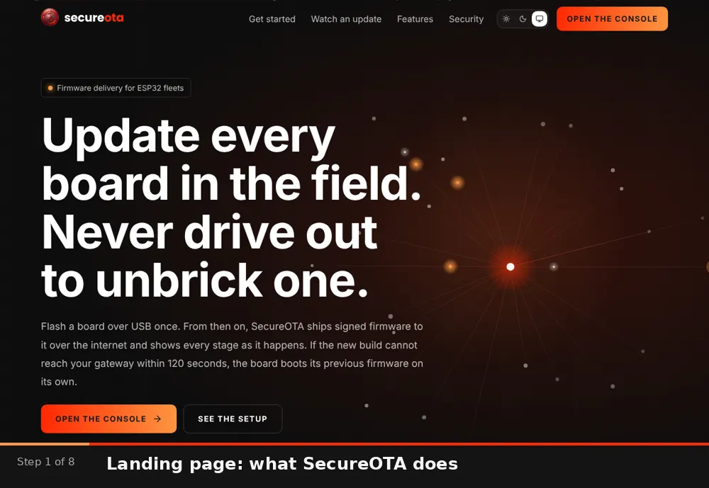
</p>

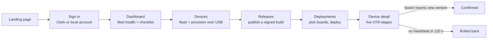

## Architecture

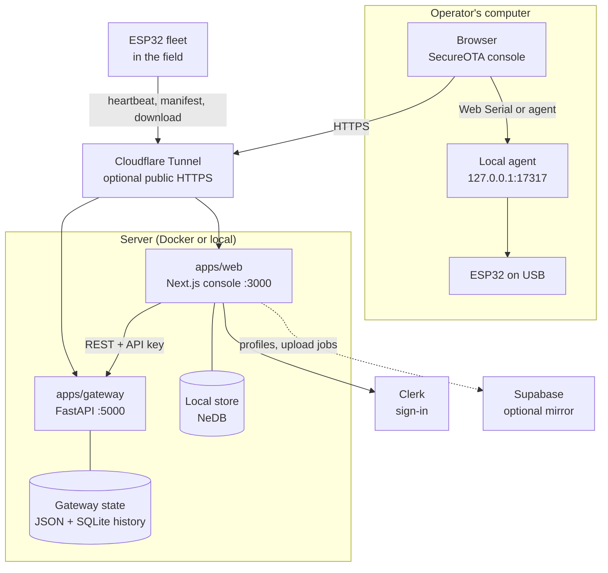

| Component | Responsibility | Key files |
|---|---|---|
| Console (`apps/web`) | Pages, auth, role checks, proxies to the gateway, USB flashing, local data | `app/`, `components/`, `lib/auth.ts`, `proxy.ts` |
| Gateway (`apps/gateway`) | Device registry, heartbeats, commands, releases, deployments, telemetry, audit | `edge_gateway.py`, `gateway/routes/`, `gateway/deployment.py` |
| Firmware (`firmware`) | Pull updates, verify, flash, health gate, provisioning protocol | `esp32_ota_main/esp32_ota_main.ino` |
| Agent (`apps/agent`) | Expose local COM ports to the console over loopback | `secureota_agent.py` |

## Security model

Each layer stops a specific attack. The **Security** section of the landing page lets you click through them.

| Layer | What it checks | Stops |
|---|---|---|
| Per-device tokens | Each board authenticates with a token issued to it alone | One stolen token reporting for, or receiving commands for, another board |
| Release signing | The gateway signs every release with Ed25519 | Tampered release metadata |
| Package signature | Secure packages are AES-256-CBC encrypted and carry an RSA-2048 signature over the version and SHA-256 of the image, checked on the board | Forged or read-out firmware |
| SHA-256 digest | The image must match the digest published for that exact version | Swapped or corrupted images |
| Anti-rollback | The gateway only offers newer builds; the board refuses lower versions | Downgrade to a vulnerable build |
| Health gate | New image must reach the gateway within 120 s or the bootloader reverts | Bricked boards from a broken build |
| Audit trail | Every change through the gateway is logged with actor, source IP and result, including refusals | Untraceable changes, key guessing |

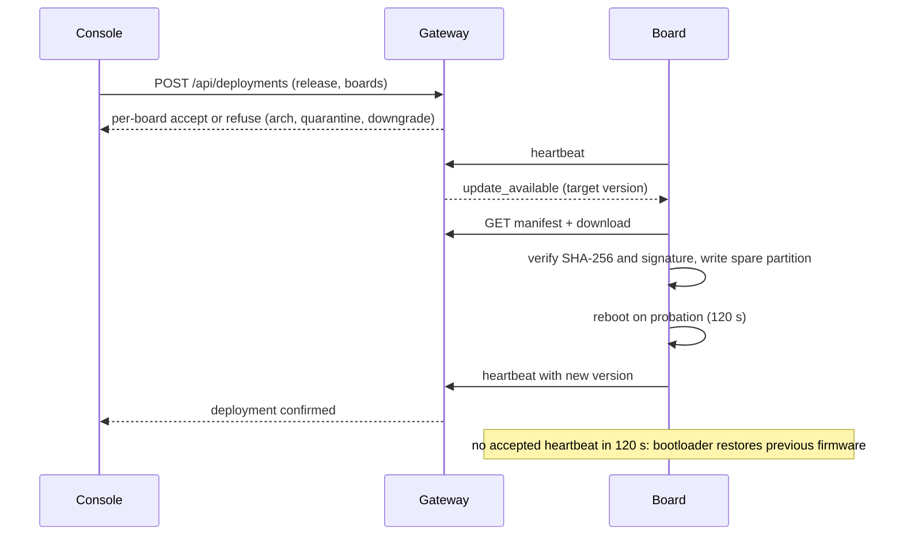

Two signature layers exist on purpose: the gateway's Ed25519 key protects release metadata on its APIs, and the RSA-2048 release key is what the ESP32 verifies before flashing. Details: [docs/architecture/OTA_ARCHITECTURE.md](docs/architecture/OTA_ARCHITECTURE.md) and [docs/guides/END_TO_END_DEMO.md](docs/guides/END_TO_END_DEMO.md).

## Screenshots

Captured from the running console with sample boards registered through the real gateway API.

| Dashboard | Deployments |
|---|---|
| 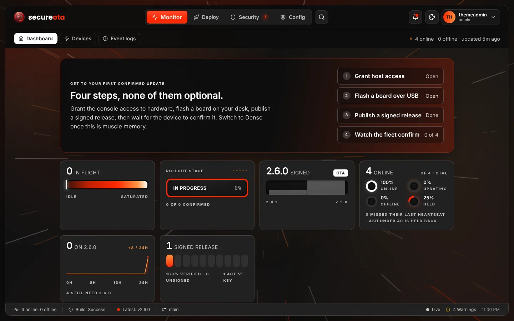 | 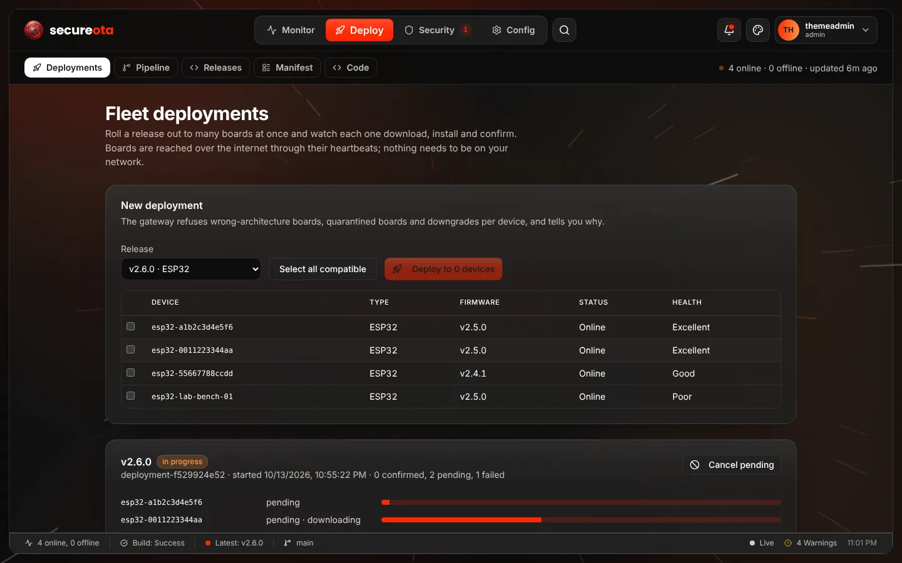 |
| **Device detail** | **Releases** |
| 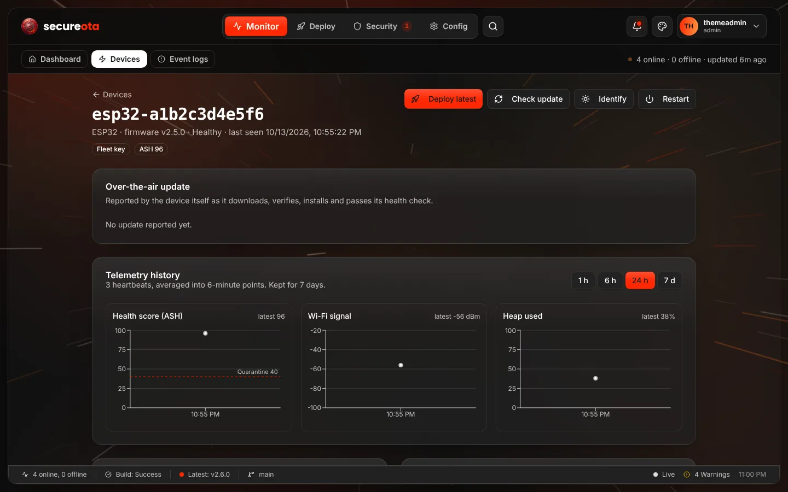 | 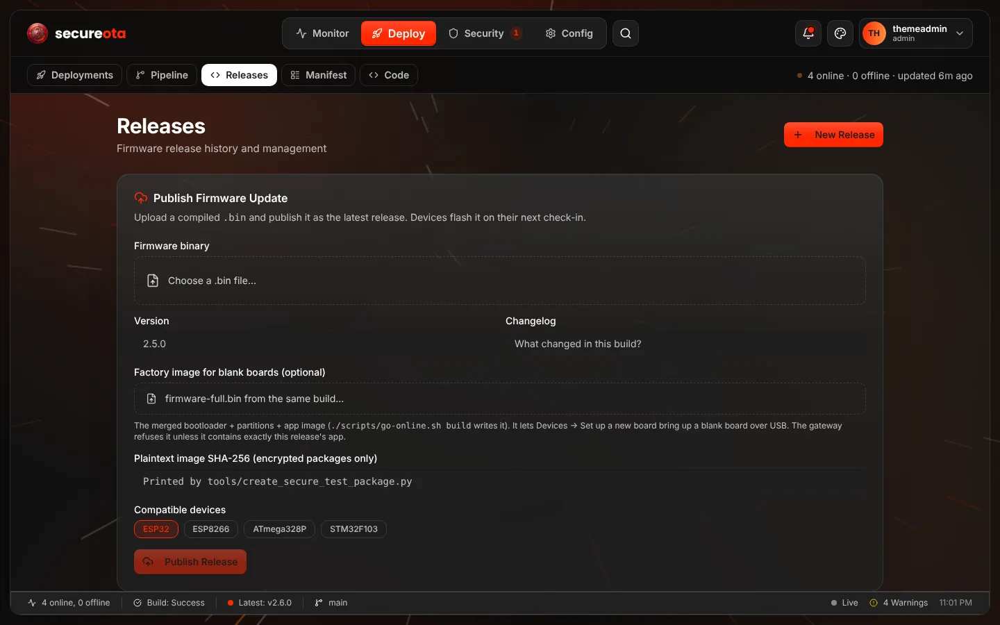 |
| **Devices (USB setup)** | **Audit trail** |
| 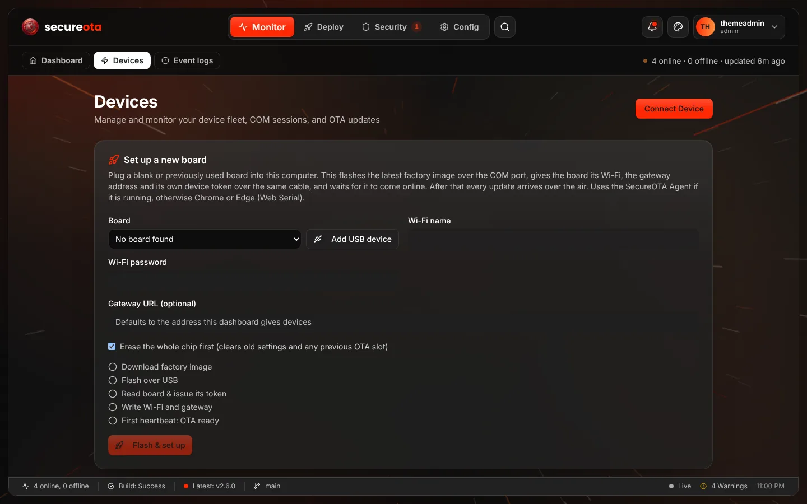 | 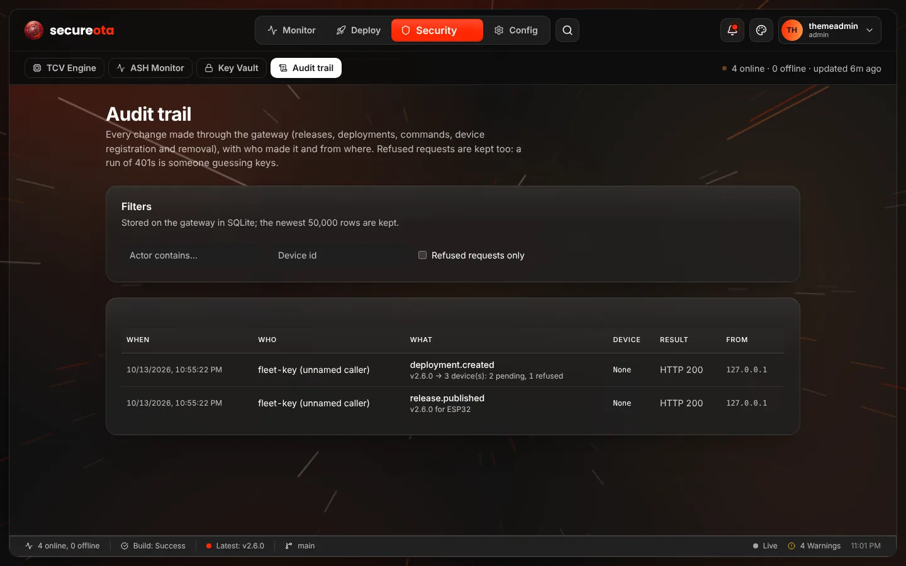 |
| **Sign in** | **Light mode** |
| 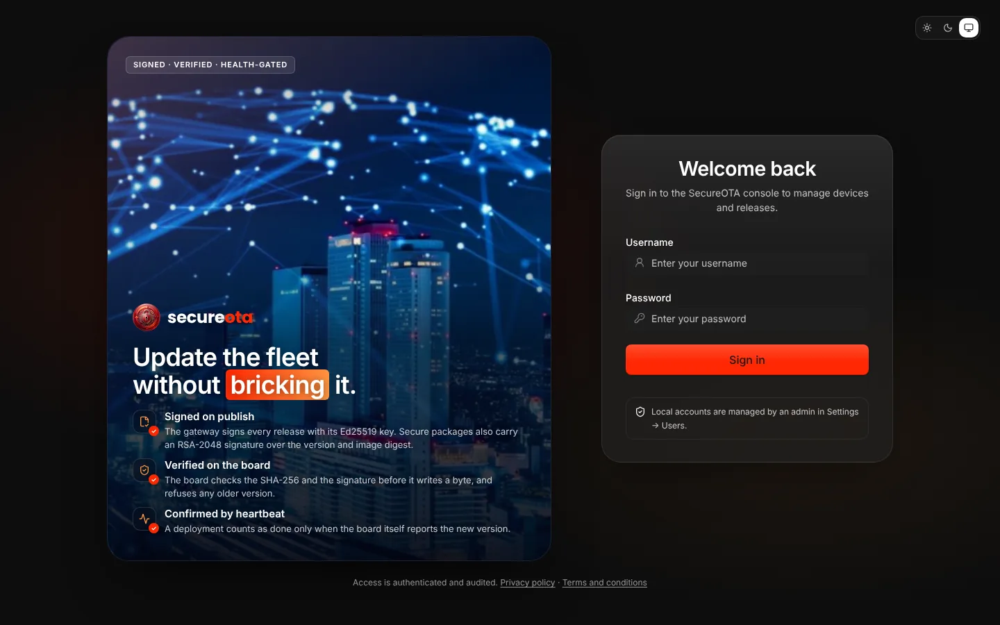 | 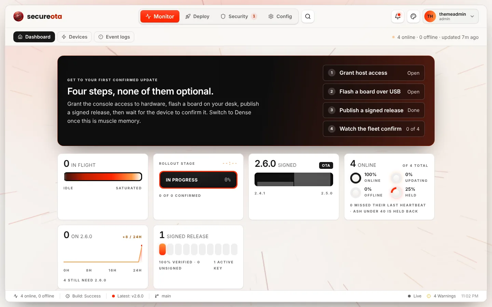 |

<p align="center">
  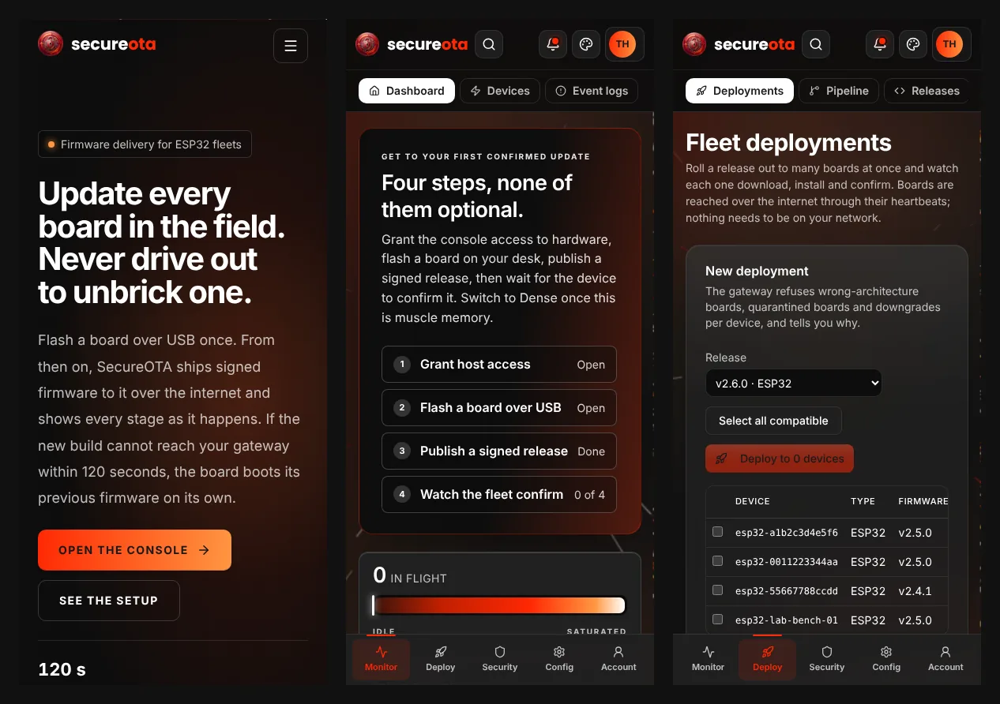
</p>

## Repository layout

```
.
├── apps/
│   ├── web/          Next.js console (landing, sign-in, fleet console, legal pages)
│   ├── gateway/      FastAPI edge gateway and its tests
│   └── agent/        Local USB agent (Python, loopback only)
├── firmware/         ESP32 OTA firmware (PlatformIO) and signing tools
├── scripts/          Windows and shell launchers, setup and acceptance scripts
├── deploy/
│   └── cloudflared/  Cloudflare Tunnel config (credentials are git-ignored)
├── docs/             Architecture, guides, design notes, images
├── assets/brand/     Source logo files
├── .github/workflows CI and firmware release pipelines
├── docker-compose*.yml
└── package.json      npm workspace root (apps/web)
```

Every folder and important file is described in **[Tree.md](Tree.md)**.

## Getting started

### Prerequisites

| Tool | Version | Needed for |
|---|---|---|
| Node.js | 20 or newer | Console |
| Python | 3.10 or newer (3.11 in Docker) | Gateway, agent |
| Docker Desktop | Compose v2 | Container deployment |
| PlatformIO | Current | Building firmware |
| Chrome or Edge | Current | Web Serial flashing |

### 1. Local development on Windows

```bat
git clone https://github.com/Rithik-sharma12/Secure_OTA_Update_Security_Mechanism.git
cd Secure_OTA_Update_Security_Mechanism
npm install
copy apps\web\.env.example apps\web\.env.local
scripts\start-dev.cmd
```

`scripts\start-dev.cmd` installs dependencies on first run, starts the gateway on port 5000 in a second window (`scripts\start-gateway.cmd`) and the console on **http://localhost:3000**. Run it again to restart or open an instance that is already running.

### 2. Local development on any OS

```bash
# Terminal 1: gateway
cd apps/gateway
python -m venv .venv && . .venv/bin/activate
pip install -r requirements.txt
OTA_GATEWAY_API_KEY=<same value as EDGE_GATEWAY_API_KEY> uvicorn edge_gateway:app --port 5000

# Terminal 2: console (from the repository root)
npm install
npm run dev
```

### 3. Docker

```bash
cp .env.example .env.docker      # then fill in the secrets
docker compose --env-file .env.docker up -d --build
```

Services: `gateway` on 5000 and `ota_ide` on 3000, with named volumes for gateway keys, firmware cache and the console database. See [docs/guides/DOCKER_DEPLOYMENT.md](docs/guides/DOCKER_DEPLOYMENT.md).

### 4. Online (Cloudflare Tunnel)

```bat
scripts\go-online.cmd          :: put it online
scripts\go-online.cmd status   :: check what is public
scripts\go-online.cmd off      :: take it offline
```

`./scripts/go-online.sh` does the same on Linux and macOS and also wraps the firmware workflow (`build`, `flash`, `monitor`, `agent`). Setup: [docs/guides/CLOUDFLARE_TUNNEL_SETUP.md](docs/guides/CLOUDFLARE_TUNNEL_SETUP.md).

## Configuration

Secrets live in `apps/web/.env.local` (local development) and `.env.docker` (containers). Both are git-ignored. Templates: [`apps/web/.env.example`](apps/web/.env.example) and [`.env.example`](.env.example).

### Console (`apps/web`)

| Variable | Purpose |
|---|---|
| `EDGE_GATEWAY_URL`, `EDGE_GATEWAY_API_KEY` | Where the gateway is and the shared API key |
| `NEXT_PUBLIC_CLERK_PUBLISHABLE_KEY`, `CLERK_SECRET_KEY` | Clerk sign-in (Google, GitHub, e-mail). Without them, local accounts are used |
| `CLERK_CLOCK_SKEW_MS` | Allowed clock difference for Clerk tokens, default 60000 |
| `NEXT_PUBLIC_SUPABASE_URL`, `NEXT_PUBLIC_SUPABASE_ANON_KEY`, `SUPABASE_SERVICE_ROLE_KEY` | Optional Supabase mirror of profiles and upload jobs |
| `OTA_ADMIN_USERNAME`, `OTA_ADMIN_PASSWORD`, `OTA_ADMIN_EMAILS` | Bootstrap admin for local accounts; e-mails that become admins under Clerk |
| `OTA_SESSION_TTL_HOURS`, `OTA_LOCAL_DB_DIR` | Session lifetime and local store location |
| `NEXT_PUBLIC_SITE_URL` | Canonical public URL for SEO |
| `NEXT_PUBLIC_LEGAL_ENTITY`, `NEXT_PUBLIC_CONTACT_EMAIL`, `NEXT_PUBLIC_GOVERNING_LAW` | Shown on the privacy policy and terms pages |

When Clerk keys are set, Clerk handles sign-in and Supabase is used only to store data.

### Gateway (`apps/gateway`)

| Variable | Purpose |
|---|---|
| `OTA_GATEWAY_API_KEY` | Key the console and fleet tools use for write access |
| `OTA_GATEWAY_KEYS_DIR`, `OTA_GATEWAY_CACHE_DIR` | Ed25519 signing keys and firmware/state cache |
| `OTA_REQUIRE_DEVICE_TOKEN` | Require per-device tokens on heartbeats |
| `OTA_PUBLIC_URL`, `OTA_LOCAL_URL`, `OTA_DEVICE_GATEWAY_URL` | Addresses devices use to reach the gateway |
| `OTA_TELEMETRY_RETENTION_DAYS`, `OTA_AUDIT_MAX_ROWS` | History retention, default 7 days and 50,000 rows |
| `OTA_GITHUB_REPOSITORY`, `OTA_GITHUB_TOKEN`, `OTA_GITHUB_WEBHOOK_SECRET` | Import releases from GitHub |
| `OTA_RELEASE_AES_KEY`, `OTA_RELEASE_RSA_PUBKEY_PATH` | Secure package encryption and verification material |

The full list with comments is in [`.env.example`](.env.example).

## Firmware

Located in [`firmware/`](firmware). Copy `esp32_ota_main/ota_config.h.example` to `ota_config.h` (git-ignored) before building.

| PlatformIO env | Board | Notes |
|---|---|---|
| `esp32dev` | ESP32 DevKit | Default |
| `esp32s3` | ESP32-S3-DevKitC-1 | |
| `esp32c3` | ESP32-C3-DevKitM-1 | |
| `esp32dev_ota` | ESP32 DevKit | ArduinoOTA push for bench work only; bypasses signature checks, never ship it |

```bash
cd firmware
pio run -e esp32dev                    # build
pio run -e esp32dev -t upload          # flash over USB
pio device monitor -b 115200           # serial monitor
```

The toolchain is pinned to `espressif32 @ 6.9.0` (Arduino-ESP32 2.0.17); the console enforces the same version. Provisioning over USB uses the `SOTA:INFO` and `SOTA:PROVISION` line protocol, described in [docs/guides/REMOTE_OTA_AND_USB_PROVISIONING.md](docs/guides/REMOTE_OTA_AND_USB_PROVISIONING.md). Release targets accepted by the gateway: ESP32, ESP8266, STM32F103 and ATmega328P; over-the-internet updates with the health gate run on the ESP32 family.

## Gateway API

Write endpoints require the API key (`x-api-key`) or a device token. Main routes:

| Method | Path | Purpose |
|---|---|---|
| POST | `/api/heartbeat` | Device check-in; returns pending commands and updates |
| GET | `/api/devices`, `/api/devices/{id}` | Fleet and device state |
| POST | `/api/devices/register` | Register a board |
| GET | `/api/devices/{id}/telemetry` | Health, Wi-Fi and memory history |
| POST | `/api/devices/{id}/commands` | Queue update, check_update, reboot or identify |
| POST | `/api/devices/{id}/ota/status` | Board reports OTA stage and progress |
| POST | `/api/devices/{id}/revoke-token` | Revoke a device token |
| GET, POST | `/api/releases`, `/api/releases/upload` | List or publish releases |
| GET | `/api/releases/latest`, `/api/releases/factory` | Newest release, merged first-flash image |
| GET, POST | `/api/deployments` | List or create deployments |
| POST | `/api/deployments/{id}/retry`, `/cancel` | Retry failed targets or cancel |
| GET | `/releases/latest/manifest`, `/releases/download/{file}` | Device manifest and firmware download |
| GET | `/releases/latest/public-key` | Gateway's Ed25519 public key |
| GET | `/api/audit` | Audit trail |
| GET | `/api/stream`, `/api/events` | Live updates for the console |
| POST | `/api/github/webhook` | GitHub release import |
| GET | `/healthz` | Liveness |

## Testing and CI

```bash
# Console: typecheck, lint, unit tests (84 tests)
npm run typecheck
npm run lint
npm test

# Gateway: pytest (201 tests)
cd apps/gateway && python -m pytest -q
```

- [`.github/workflows/ci.yml`](.github/workflows/ci.yml) runs the gateway tests, the console checks and a dependency audit on every push.
- [`.github/workflows/firmware-release.yml`](.github/workflows/firmware-release.yml) builds the firmware with PlatformIO and publishes `.bin` files, checksums and a release manifest.
- [`scripts/acceptance-test.ps1`](scripts/acceptance-test.ps1) runs the end-to-end acceptance checklist in [docs/architecture/ACCEPTANCE_TESTS.md](docs/architecture/ACCEPTANCE_TESTS.md).

## Design rules

The interface follows fixed rules so it reads as a product, not a template:

- Buttons and tabs have 8px corners. No pill shapes.
- No purple gradients. Themes: Ember (default), Ocean, Emerald, Rose, Graphite, Crimson and Sunset, each in light and dark.
- No scroll-triggered or cursor-following animation, no emoji icons, no em dashes in copy.
- No invented numbers: every figure on the site is a property of the code or live data.
- Responsive from 360px phones to ultrawide screens; phones get a bottom tab bar.

Design notes: [docs/design/](docs/design).

## Documentation

| Document | Contents |
|---|---|
| [Tree.md](Tree.md) | Every folder and important file, with its purpose |
| [docs/how-to-run.md](docs/how-to-run.md) | Running locally and online, step by step |
| [docs/guides/END_TO_END_DEMO.md](docs/guides/END_TO_END_DEMO.md) | Full demo from firmware build to confirmed OTA |
| [docs/guides/DEPLOYMENT.md](docs/guides/DEPLOYMENT.md) | Cloud VPS deployment |
| [docs/guides/REMOTE_OTA_AND_USB_PROVISIONING.md](docs/guides/REMOTE_OTA_AND_USB_PROVISIONING.md) | Remote commands and USB provisioning |
| [docs/architecture/OTA_ARCHITECTURE.md](docs/architecture/OTA_ARCHITECTURE.md) | System and protocol architecture |
| [docs/SECURITY_REMEDIATION.md](docs/SECURITY_REMEDIATION.md) | Security fixes and secrets that need rotating |
| [docs/README.md](docs/README.md) | Index of all documentation |

## Team and license

Built by Rithik Sharma, Priyankaa Devi S and Ritesh V as the *Secure Heterogeneous OTA Update Mechanism* project.

The project is not under an open-source license (`"license": "UNLICENSED"` in `package.json`). All rights reserved by the authors. Use of the hosted service is governed by its [terms and conditions](apps/web/app/terms/page.tsx) and [privacy policy](apps/web/app/privacy/page.tsx).

Report issues at [GitHub Issues](https://github.com/Rithik-sharma12/Secure_OTA_Update_Security_Mechanism/issues).
