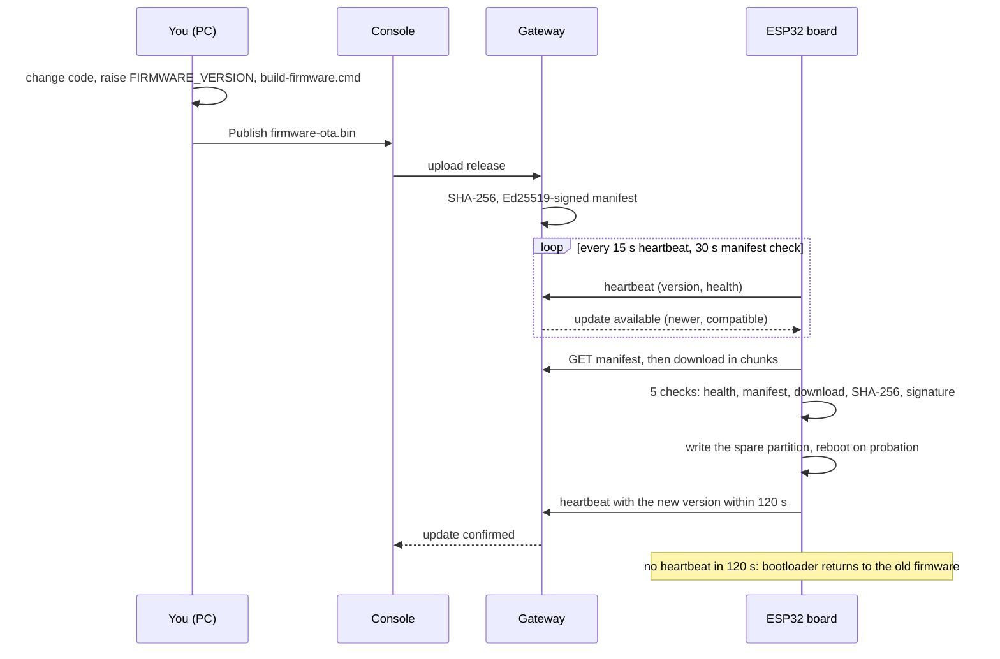

# SecureOTA User Manual

How to run the platform, prepare a board for over-the-air (OTA) updates, ship new firmware to it, and understand what happens at every step. Written for Windows, which is what the scripts target; the same steps work on Linux and macOS with the Python and Docker commands shown.

---

## Contents

1. [What SecureOTA does](#1-what-securetoa-does)
2. [How an update travels](#2-how-an-update-travels)
3. [Before you start](#3-before-you-start)
4. [Start the platform](#4-start-the-platform)
5. [Sign in and roles](#5-sign-in-and-roles)
6. [Build the firmware](#6-build-the-firmware)
7. [Initialize a board (first flash)](#7-initialize-a-board-first-flash)
8. [Check that the board is online](#8-check-that-the-board-is-online)
9. [Release a new version](#9-release-a-new-version)
10. [Deliver it to the boards](#10-deliver-it-to-the-boards)
11. [What the board does during an update](#11-what-the-board-does-during-an-update)
12. [Health score and quarantine](#12-health-score-and-quarantine)
13. [Security mechanisms](#13-security-mechanisms)
14. [Other boards](#14-other-boards)
15. [Troubleshooting](#15-troubleshooting)
16. [Reference](#16-reference)

---

## 1. What SecureOTA does

A board is flashed over USB **once**. From then on every new firmware version reaches it over the internet. The gateway signs each release, the board checks it in five stages before it switches to it, and a new build that cannot reach the gateway within 120 seconds is undone by the bootloader.

| Part | Folder | What it is |
|---|---|---|
| Console | `apps/web` | The website you use: sign-in, devices, releases, deployments, USB flashing (Next.js, port 3000) |
| Gateway | `apps/gateway` | The server the boards talk to: registry, heartbeats, signing, releases, deployments, audit (FastAPI, port 5000) |
| Firmware | `firmware/esp32_ota_main` | The program on the ESP32: update client, five-stage verification, health gate, USB provisioning |
| USB agent | `apps/agent` | A small program on your PC that flashes boards with esptool (the same tool the Arduino IDE uses) |
| Shared library | `firmware/lib/sota_core` | Ed25519 manifest check, SHA-256, version and health rules used by every board |

Public addresses in the online deployment:

| Address | Used by |
|---|---|
| `https://ota.nyx-ctf.tech` | You, in the browser (console) |
| `https://gw.nyx-ctf.tech` | The boards (gateway) |

---

## 2. How an update travels



---

## 3. Before you start

### Software on your PC

| Tool | Why |
|---|---|
| Python 3.10 or newer, "Add python.exe to PATH" ticked | Build script, USB agent, flash script, local gateway |
| Docker Desktop | Running the console and gateway online |
| Node.js 20 or newer | Only for local development of the console |
| PlatformIO **or** Arduino IDE 2 with the **esp32 2.0.17** core | Building the firmware (the build script finds either) |
| Chrome or Edge | The console; browser flashing is a fallback only |
| CP210x or CH340 USB driver | So Windows shows the board as a COM port |

### Secret files (never committed)

| File | Holds | Created by |
|---|---|---|
| `.env.docker` | Gateway API key, admin password, Clerk keys, Cloudflare settings | You, from `.env.example` |
| `apps/web/.env.local` | Same, for local development | You, from `apps/web/.env.example` |
| `deploy/cloudflared/credentials.json`, `config.yml` | Cloudflare Tunnel | Cloudflare dashboard |
| `firmware/secure-keys/` | Release signing (RSA-2048) and encryption (AES-256) keys | First run of `build-firmware.cmd`. **Back it up**: boards only accept packages made with these keys |
| `firmware/esp32_ota_main/ota_config.h` | Wi-Fi, gateway address, API key, release public key | First run of `build-firmware.cmd` |

---

## 4. Start the platform

### Online (normal use)

```bat
scripts\go-online.cmd
```

It runs eight checked steps and stops at the first one that fails, saying why:

1. Configuration and tunnel credentials present.
2. Shows the branch and commit it deploys, and how many uncommitted changes are included.
3. Compares `firmware\dist` with the firmware code and offers to rebuild it (answer N to keep the old image).
4. Starts Docker Desktop.
5. Frees ports 3000 and 5000.
6. Builds the gateway and console images from **this folder** and recreates every container. Data volumes (keys, releases, users) are kept.
7. Waits until both containers are healthy.
8. Waits for the Cloudflare Tunnel, then prints `ONLINE` with the deployed commit.

| Command | Does |
|---|---|
| `scripts\go-online.cmd update` | `git pull` first (refused while you have uncommitted changes), then the same |
| `scripts\go-online.cmd status` | Containers, tunnel, local and public addresses |
| `scripts\go-online.cmd logs` | Recent logs of every container (also in `deploy\last-run.log`) |
| `scripts\go-online.cmd off` | Stops everything; data and keys are kept |

Run `go-online.cmd` again **every time you change console or gateway code**; the website does not read files from your PC on its own.

### Local development

```bat
scripts\start-dev.cmd
```

Opens the gateway (port 5000), the USB agent and the console on http://localhost:3000. Boards on your Wi-Fi then use `http://<your PC's IPv4>:5000` as the gateway (allow Python through Windows Firewall on private networks).

### The USB agent

```bat
scripts\start-agent.cmd
```

Keep its window open whenever you flash or set up a board from the console. It lists the board's COM port first, checks that no other program holds the port, and flashes with esptool. If an older agent is already running, the script replaces it.

---

## 5. Sign in and roles

Open the console and sign in (Clerk: Google, GitHub or e-mail; or the local admin account from `OTA_ADMIN_USERNAME` / `OTA_ADMIN_PASSWORD`).

| Role | Can |
|---|---|
| Viewer | See everything, change nothing (new Clerk accounts start here) |
| Operator | Flash and set up boards, publish releases, deploy, send device commands |
| Admin | Everything, plus user management (Profile, User management) |

E-mails listed in `OTA_ADMIN_EMAILS` become admins automatically.

---

## 6. Build the firmware

### Set the version

In `firmware/esp32_ota_main/esp32_ota_main.ino`:

```cpp
#define FIRMWARE_VERSION    "2.5.2"
#define FIRMWARE_VERSION_N  2005002   // MAJOR*1000000 + MINOR*1000 + PATCH
```

Every release must have a **higher** version than the boards run; the gateway and the board both refuse anything else.

### Build

```bat
scripts\build-firmware.cmd
```

Outputs in `firmware\dist\esp32dev\`:

| File | Flash address | Use |
|---|---|---|
| `firmware-full.bin` | `0x0` | First flash of a new or blank board: bootloader, partition table and app in one file |
| `firmware.bin` | `0x10000` | App only, for a board that already has the SecureOTA bootloader and partitions |
| `firmware-ota.bin` | not flashed | The signed, encrypted package you **publish** for over-the-air updates |
| `build-info.json`, `SHA256SUMS.txt` | | Version and SHA-256 of each file; the console checks them |

The first build also creates `firmware\secure-keys\` and `ota_config.h`. Other boards (`esp32s3`, `esp32c3`): `scripts\build-firmware.cmd esp32s3`.

---

## 7. Initialize a board (first flash)

Pick **one** of the three ways. All of them put SecureOTA firmware on the board; the board then needs its Wi-Fi, the gateway address and its credentials (step 7.4), unless you compiled them in.

### 7.1 From the console (recommended)

1. Start the USB agent (`scripts\start-agent.cmd`) and plug in the board.
2. Console: **Devices → Set up a new board**.
3. Firmware: **This computer's build** (it shows the path of `firmware-full.bin`).
4. Board: the COM port marked "(agent)". Enter the Wi-Fi name and password. Gateway URL can stay empty (the configured public address is used).
5. Keep **Erase the whole chip first** ticked for a new board. Click **Start**.

The console flashes the board, reads its device ID, registers it and issues its own device token, writes Wi-Fi, gateway URL, token and the gateway's Ed25519 key over the cable, and waits for the first heartbeat. If the board is found in download mode while "already runs SecureOTA" was ticked, it flashes the factory image anyway.

### 7.2 With the flash script (like the Arduino IDE's Upload button)

```bat
scripts\flash-board.cmd                 :: finds the board, flashes firmware-full.bin, shows it booting
scripts\flash-board.cmd --port COM7     :: a specific port
scripts\flash-board.cmd --erase         :: wipe the chip first
scripts\flash-board.cmd --list          :: list serial ports
```

It skips Bluetooth COM ports, checks the port is free, uploads at 921600 baud with automatic reset, retries slower if data is lost, and gives you a 40 s window for manual download mode if the automatic reset does not work. Then finish with the console: **Devices → Set up a new board**, tick **The board already runs SecureOTA firmware** (writes Wi-Fi, gateway and token only).

### 7.3 With the Arduino IDE

1. Make the sketch folder (it includes your `ota_config.h` and the Ed25519 library, so it contains secrets and is git-ignored):
   ```bat
   python firmware\tools\export_arduino_sketch.py
   ```
2. Arduino IDE: Boards Manager → **esp32 by Espressif Systems 2.0.17**. Library Manager → **ArduinoJson 7**.
3. Open `firmware\arduino-ide\esp32_ota_main\esp32_ota_main.ino`.
4. Tools:

   | Setting | Value |
   |---|---|
   | Board | **ESP32 Dev Module** (not Wrover: a Wrover setting on a board without PSRAM hangs right after `entry 0x...`) |
   | Port | the CP210x / CH340 COM port |
   | Partition Scheme | **Default 4MB with spiffs** (two app slots, needed for OTA) |
   | Upload Speed | 921600 (115200 if the upload breaks) |
   | Erase All Flash Before Sketch Upload | Enabled for the first upload |

5. **Upload**. If it hangs on "Connecting...", hold BOOT, tap EN, release BOOT.

With Wi-Fi and gateway compiled in through `ota_config.h`, the board is ready after the upload.

### 7.4 Board settings: compiled in or written over USB

`ota_config.h` values are **defaults**; anything written over USB (stored in the board's NVS, kept across updates) takes precedence.

| Setting | `ota_config.h` | Over USB (`SOTA:PROVISION` field) |
|---|---|---|
| Wi-Fi name / password | `WIFI_SSID`, `WIFI_PASSWORD` | `ssid`, `password` |
| Gateway address | `BACKEND_URL`, e.g. `https://gw.nyx-ctf.tech` (no trailing `/`) | `backend_url` |
| Fleet API key | `BACKEND_API_KEY` = `OTA_GATEWAY_API_KEY` in `.env.docker` | `api_key` |
| Device token (preferred over the fleet key) | `DEVICE_TOKEN` | `device_token` |
| Device ID | `DEVICE_ID` (`auto` = from the chip's MAC) | `device_id` |
| Gateway Ed25519 key (turns on stage 5) | `GATEWAY_ED25519_PUBKEY` | `gateway_key` |
| Release keys (secure packages) | `FIRMWARE_ENC_KEY`, `FIRMWARE_PUB_KEY` (filled by the build) | not writable over USB |

The ESP32 only joins **2.4 GHz** Wi-Fi. A phone hotspot set to 5 GHz never connects.

Writing settings by hand from any serial monitor (115200 baud, newline line ending):

```
SOTA:INFO
SOTA:PROVISION {"ssid":"MyWiFi","password":"secret","backend_url":"https://gw.nyx-ctf.tech","device_token":"...","reset_health":true}
SOTA:RESET-CONFIG
```

`SOTA:INFO` answers with the device ID, version, Wi-Fi state, gateway, health score and whether a token and gateway key are set. `SOTA:PROVISION` answers `SOTA:OK` and reboots.

---

## 8. Check that the board is online

Serial Monitor at **115200**, press **EN** once:

```
[OTA] Firmware v2.5.1 starting...
[WiFi] Connecting to <your Wi-Fi>....
[WiFi] Connected. IP: 10.140.240.243
[OTA] Setup complete
[TLS] Clock synced: ...
[Health] poll success: 100 +1 -> 100
[Backend] Checking for firmware update...
[Backend] Current v2.5.1 (2005001), Remote 2.5.1 (2005001)
[Backend] Device is up to date
```

Lines such as `nvs_erase_key fail: expectver NOT_FOUND` on the first boot are harmless: the firmware clears update bookkeeping that does not exist yet.

In the console, **Devices** lists the board with its version, health score, IP, signal and last-seen time. Open it for telemetry, the OTA stage history and commands.

---

## 9. Release a new version

1. Change the code, raise `FIRMWARE_VERSION` and `FIRMWARE_VERSION_N` (section 6).
2. `scripts\build-firmware.cmd`.
3. Publish, one of:
   - **Devices → Flash over USB → This computer's build → Publish as a release**: uploads `firmware-ota.bin` with its version and image SHA-256, and `firmware-full.bin` as the factory image, in one step.
   - **Releases** page: upload `firmware-ota.bin`, version as set in the sketch, compatible `ESP32`.
   - A GitHub release (the firmware-release workflow, or the gateway's GitHub import).

The gateway stores the file, computes its SHA-256, and builds and signs the manifest the boards read:

| Manifest field | Meaning |
|---|---|
| `version` | Release version |
| `sha256` | Digest of the file as served |
| `imageSha256` | Digest of the decrypted image (secure packages) |
| `size` | Bytes |
| `securePackage` | The file is an encrypted, RSA-signed package |
| `manifestSignature` | Gateway Ed25519 signature over `version`, `sha256`, `imageSha256`, `size` |
| `downloadUrl`, `compatible` | Where to download, which board types |

A release can be **archived** on the Releases page: it is withdrawn from the manifest and from deployments, and can be restored.

---

## 10. Deliver it to the boards

| Way | When |
|---|---|
| **Automatic** (`OTA_AUTO_UPDATE=true`, the default) | Every board picks up the newest compatible release on its next check (about 30 s) |
| **Deployments** page | Choose a release and boards. The gateway accepts or refuses each board and says why (wrong board type, quarantined, would be a downgrade). A deployment counts as done only when each board reports the new version; targets not confirmed within 30 minutes are marked failed and can be retried |
| **Device commands** (device page) | `check_update` (look now), `update` (install a given version), `reboot`, `identify` (blink the LED). Delivered with the next heartbeat |

---

## 11. What the board does during an update

### The five checks

| Stage | Check | On failure |
|---|---|---|
| 1. Connectivity and health | Gateway reachable; health score not in quarantine | Skip this round (-1 when unreachable) |
| 2. Manifest validation | Required fields present; version strictly newer; not a version that already failed here; board type matches; secure package only with secure keys | Nothing downloaded |
| 3. Chunk-based download | Image streamed into the **spare** OTA partition; for secure packages decrypted on the fly | Partition discarded |
| 4. SHA-256 integrity | Digest of the image equals `imageSha256` / `sha256` from the manifest; secure packages also verify the RSA-2048 signature over version and digest | Discarded, -25 |
| 5. Ed25519 signature | Gateway signature over version, digests and size, checked with the gateway key stored on the board | Discarded, -30 |

Only when all five pass does the board switch its boot partition. The running firmware is never overwritten.

Stage 5 runs when the board holds the gateway's Ed25519 key (written by **Set up a new board**, or `GATEWAY_ED25519_PUBKEY`). Without it the log says `[Stage 5] SKIPPED` and stages 1 to 4 still protect the update.

### Expected log

```
[Backend] Current v2.5.1 (2005001), Remote 2.5.2 (2005002)
[Backend] Update available: https://gw.nyx-ctf.tech/releases/download/...
[Update] Secure OTA configuration detected
[Update] Signed version v2.5.2 verified.
[Update] Manifest sha256 matches the decrypted image.
[Stage 5] Ed25519 manifest signature valid (... ms).
[Update] Signature verified. Writing ... bytes to flash.
[Backend] Update successful. Rebooting.
[OTA] Firmware v2.5.2 starting...
```

### Health gate and rollback

After the reboot the new image runs **on probation**. It must join Wi-Fi and get a heartbeat accepted within **120 s** (`OTA_HEALTH_GATE_TIMEOUT_SECONDS`). Then it is marked valid, the board reports `succeeded`, and the console marks the deployment confirmed. Otherwise the bootloader starts the previous firmware, the board reports `rolled_back`, loses 25 health points, and skips that version until a newer one appears.

---

## 12. Health score and quarantine

Every board keeps a score from 0 to 100 in its flash (it survives reboots and power cuts) and sends it with each heartbeat.

| Event | Change |
|---|---|
| Successful check, nothing to update | +1 |
| Update installed | +10 |
| Gateway unreachable | -1 |
| Update failed (download, digest, package signature) | -25 |
| Ed25519 manifest signature invalid | -30 |
| New image rolled back by the health gate | -25 |

Below **40** the board enters **quarantine**: it keeps sending heartbeats but installs nothing. Quarantine lifts when the score is back at 100. To clear it after fixing the cause, set the board up again from the console (it resets the score) or send `SOTA:PROVISION {"reset_health":true}` over USB. The **Health monitor** page shows every board's score history.

---

## 13. Security mechanisms

| Layer | Protects against |
|---|---|
| Per-device token (issued at setup, revocable on the device page) | A stolen token acting for another board |
| Fleet API key on writes, roles in the console, audit log | Unauthorised releases, deployments and commands; untraceable changes |
| TLS to `gw.nyx-ctf.tech` (bundled Cloudflare root certificates) | Reading or altering traffic in transit |
| AES-256-CBC encrypted package | Reading the firmware from the download |
| RSA-2048 signature over version and image digest (release keys in `firmware\secure-keys`) | Forged or modified firmware |
| SHA-256 digest from the manifest | Corrupted or swapped images |
| Ed25519 manifest signature (gateway key) | Forged manifests; ties version, digests and size to the gateway |
| Anti-rollback (gateway and board) | Downgrade to an older, vulnerable build |
| Health gate and automatic rollback | A broken build bricking the fleet |
| Health score and quarantine | A board under repeated attack or failure |

Keys and where they live:

| Key | Location | Effect if lost |
|---|---|---|
| Release RSA private key + AES key | `firmware\secure-keys\` on the build PC | Boards cannot accept new packages until reflashed with new keys: **back it up** |
| Gateway Ed25519 key | Docker volume `secureota_gateway_keys` | Boards with stage 5 on reject new manifests until set up again |
| Gateway API key | `.env.docker` (`OTA_GATEWAY_API_KEY`) | Change it in `.env.docker` and on the boards |

`OTA_ALLOW_INSECURE_TLS 1` in `ota_config.h` turns off the gateway certificate check. Use it only on a bench board; keep it `0` (or absent) for deployed boards.

---

## 14. Other boards

| Board | Folder | How it updates | Status |
|---|---|---|---|
| ESP32 | `firmware/esp32_ota_main` | Wi-Fi, all five stages, automatic rollback | Runs on hardware |
| ESP8266 | `firmware/esp8266_ota_main` | Wi-Fi, all five stages; no automatic rollback | Compiles; not yet run on hardware |
| STM32F103 | `firmware/stm32f103_ota_agent` | UART link host, Ed25519 on the board, image staged in SPI flash | Compiles; tested end to end on a PC |
| ATmega328P | `firmware/atmega328p_ota_agent` | UART link host, signature checked by the gateway, DualOptiboot | Compiles; tested end to end on a PC |

Boards without Wi-Fi need the link host running on a PC or Raspberry Pi wired to them:

```bat
python apps\agent\sota_link.py --port COM8 --gateway https://gw.nyx-ctf.tech --token <device token>
```

Wiring, build settings and the link protocol: [firmware/BOARDS.md](../firmware/BOARDS.md).

---

## 15. Troubleshooting

### Flashing

| You see | Cause | Do |
|---|---|---|
| "The board never entered download mode and printed nothing" | Wrong COM port, charge-only cable, missing driver, or the browser could not reset the board | Use `scripts\flash-board.cmd` or the agent; try another data cable; install the CP210x / CH340 driver |
| "The board is in download mode but does not answer" (browser) | Chrome / USB driver drop the bytes | Flash with `scripts\flash-board.cmd` or the agent, not the browser |
| "COMx is in use by another program" | Serial Monitor, PuTTY, PlatformIO, a browser tab | Close it, retry |
| Upload stops partway | Cable, hub or adapter loses data at 921600 | The tools retry slower; use a port on the PC itself |
| Log stops after `entry 0x400805b4` | Board type set to ESP32 **Wrover** on a board without PSRAM | Select **ESP32 Dev Module**, upload again |

### Connecting

| You see | Cause | Do |
|---|---|---|
| `[WiFi] Connecting....` forever | Wrong password, or a 5 GHz network | Use 2.4 GHz; re-provision the Wi-Fi |
| `[TLS] Syncing clock via NTP` never ends | No internet on that Wi-Fi | Check the hotspot has data |
| `[HB] Gateway answered 401` | API key or device token does not match the gateway | Set the board up again from the console, or fix `BACKEND_API_KEY` |
| Board shows offline in the console | No heartbeat for a while | Check its serial log; `scripts\go-online.cmd status` |
| `https://ota.nyx-ctf.tech` shows Cloudflare error 1033 | Tunnel not running | `scripts\go-online.cmd`, then `logs` |

### Updating

| You see | Cause | Do |
|---|---|---|
| `Device is up to date` after publishing | Same version as the board | Raise `FIRMWARE_VERSION` and `FIRMWARE_VERSION_N`, rebuild, publish |
| `Anti-rollback blocked downgrade package` | Release older than the board | Expected; publish a higher version |
| `...already failed its health check here` | This version was rolled back on this board | Fix it and publish a newer version |
| `Image does not match the manifest sha256` | Corrupted or altered file | Rebuild and publish again |
| `The release is an encrypted package but this device has no FIRMWARE_ENC_KEY` | Board built without the release keys | Reflash with a build from `build-firmware.cmd` |
| `[Stage 5] REJECTED` | Manifest not signed by the gateway the board trusts (gateway keys changed, or old gateway code) | `scripts\go-online.cmd`; set the board up again to store the current key |
| `[Health] QUARANTINE enabled` | Score below 40 | Fix the cause, then reset the score (section 12) |
| `rolled_back` in the console | New image could not reach the gateway within 120 s | Check Wi-Fi / gateway settings in the new build |

---

## 16. Reference

### Scripts

| Script | Purpose |
|---|---|
| `scripts\go-online.cmd [update\|status\|logs\|off]` | Build from this folder and run everything online |
| `scripts\start-dev.cmd` | Local console, gateway and agent |
| `scripts\start-gateway.cmd` | Local gateway only (port 5000) |
| `scripts\start-agent.cmd` | USB agent (127.0.0.1:17317) |
| `scripts\build-firmware.cmd [env]` | Build the firmware images into `firmware\dist\<env>` |
| `scripts\flash-board.cmd` | Flash `firmware-full.bin` like the Arduino IDE |
| `python firmware\tools\export_arduino_sketch.py` | Arduino IDE sketch folder with config and libraries |
| `python apps\agent\sota_link.py` | UART link host for ATmega328P / STM32F103 |

### Timings

| What | Default | Setting |
|---|---|---|
| Heartbeat | 15 s | firmware `HEARTBEAT_INTERVAL_MS` |
| Update check | 30 s | `OTA_CHECK_INTERVAL_SECONDS` |
| Health gate after an update | 120 s | `OTA_HEALTH_GATE_TIMEOUT_SECONDS` |
| Deployment confirmation window | 30 min | gateway |
| Quarantine threshold | below 40 | firmware `HEALTH_QUARANTINE` |

### Ports

| Port | Service |
|---|---|
| 3000 | Console |
| 5000 | Gateway |
| 17317 (loopback only) | USB agent |

### Tests

```bat
cd apps\gateway && python -m pytest -q            :: gateway
npm test                                           :: console
sh firmware/lib/sota_core/test/run.sh              :: Ed25519 / SHA-256 library (Linux, macOS, Git Bash)
cd apps\agent && python -m pytest tests            :: UART agent end to end
```

### More documentation

| Document | Covers |
|---|---|
| [README.md](../README.md) | Overview, configuration variables, gateway API |
| [firmware/BOARDS.md](../firmware/BOARDS.md) | All four boards, build settings, UART link protocol |
| [firmware/SETUP_GUIDE.md](../firmware/SETUP_GUIDE.md) | Toolchain and hardening a deployed board |
| [docs/how-to-run.md](how-to-run.md) | Running locally and online |
| [docs/guides/CLOUDFLARE_TUNNEL_SETUP.md](guides/CLOUDFLARE_TUNNEL_SETUP.md) | Tunnel and DNS setup |
| [docs/guides/REMOTE_OTA_AND_USB_PROVISIONING.md](guides/REMOTE_OTA_AND_USB_PROVISIONING.md) | Provisioning protocol details |
| [Tree.md](../Tree.md) | Every folder and file |
